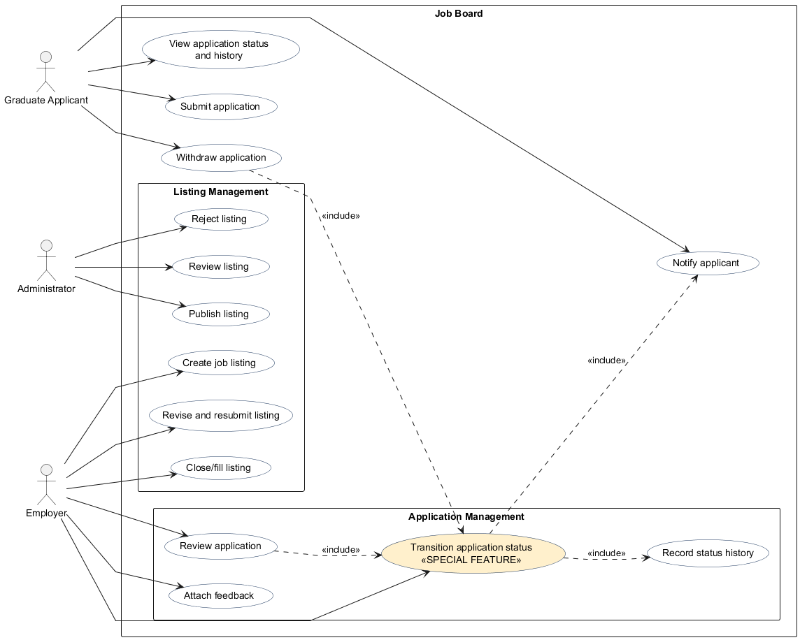
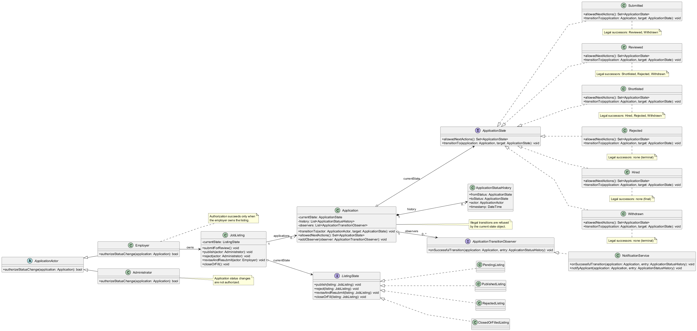

<!-- pagebreak -->

# COMP 3613

## Sprint 1 — Job Board

**Group:** NullPointers  
**Date:** 12 November 2026

| Member name | Student ID | GitHub username |
|---|---|---|
| Mark Mooradan | [PLACEHOLDER] | [PLACEHOLDER] |
| Darian Jagdeo | [PLACEHOLDER] | [PLACEHOLDER] |
| Kayden Singh | [PLACEHOLDER] | [PLACEHOLDER] |
| Alijah Samaroo | [PLACEHOLDER] | [PLACEHOLDER] |

---

## Table of Contents

1. [Cover](#comp-3613)
2. [Group Members](#group-members)
3. [Assigned Project Details](#assigned-project-details)
4. [Links](#links)
5. [Requirements](#requirements)
6. [Use Case Diagram](#use-case-diagram)
7. [Class Diagram](#class-diagram--application-state-pattern)
8. [Pattern Rationale](#7-pattern-rationale)
9. [Sprint 1 Report](#sprint-1-report)

<!-- pagebreak -->

# Group Members

| Name | Student ID | GitHub username | Trello role |
|---|---|---|---|
| Mark Mooradan | [PLACEHOLDER] | [PLACEHOLDER] | [PLACEHOLDER] |
| Darian Jagdeo | [PLACEHOLDER] | [PLACEHOLDER] | [PLACEHOLDER] |
| Kayden Singh | [PLACEHOLDER] | [PLACEHOLDER] | [PLACEHOLDER] |
| Alijah Samaroo | [PLACEHOLDER] | [PLACEHOLDER] | [PLACEHOLDER] |

---

<!-- pagebreak -->

# Assigned Project Details

- **Scenario:** Scenario 1 — Job Board
- **Special feature:** Application lifecycle and transitions. Applicants currently have no visibility into where their application stands, and status changes are not governed by enforced rules.
- **Repository URL:** https://github.com/Mark-Mooradan/comp3613-job-board.git
- **Deployed application:** [PLACEHOLDER] (to be provided in Sprint 3)

---

<!-- pagebreak -->

# Links

- **Repository:** https://github.com/Mark-Mooradan/comp3613-job-board.git
- **Trello invite:** [PLACEHOLDER]

---

<!-- pagebreak -->

# Requirements

The special feature is **application lifecycle and transitions**: governing application status changes and making application progress visible to applicants.

## Functional Requirements

| ID | Priority | Requirement | Acceptance note | Interview traceability |
|---|---|---|---|---|
| F1 | Must | Legal transitions only. An employer can move an application only along submitted → reviewed → shortlisted or rejected, then shortlisted → hired or rejected. | Accept only submitted → reviewed, reviewed → shortlisted or rejected, and shortlisted → hired or rejected. | Stakeholder interview: application transition paths |
| F2 | Must | Illegal transitions are blocked with an explanation. Rejected is terminal; hired is final; withdrawn cannot be transitioned; backward moves are not permitted. | Refuse each disallowed move without changing state and explain why it is invalid. | Stakeholder interview: invalid and terminal transitions |
| F3 | Must | Only the employer who owns the job listing may change an application's status. | Refuse administrators and other employers; a refused request leaves the status unchanged. | Stakeholder interview: application ownership and authority |
| F4 | Must | Every successful status change automatically notifies the applicant. | Send a notification for every successful transition. | Stakeholder interview: applicant notification |
| F5 | Must | Application detail shows the current status, allowed next actions, and a timestamped history of every transition. | Show each history entry's from-status, to-status, actor, and time. | Stakeholder interview: status visibility and history |
| F6 | Should | Employers can attach a feedback note to an application, and the applicant can read it. | An employer can add feedback and the applicant can view that note. | Stakeholder interview: employer feedback |
| F7 | Should | A listing goes pending → published or rejected. A rejected listing can be revised and resubmitted; only an administrator publishes it. | Support rejection, employer revision and resubmission, and administrator-only publication. | Stakeholder interview: listing review lifecycle |
| F8 | Should | Closing or filling a listing marks its in-progress applications inactive; deleting a listing removes its tied applications; minor edits do not affect in-progress applications. | Apply each specified listing action to its tied applications as described. | Stakeholder interview: listing closure and application effects |
| F9 | Could | Provide an applicant dashboard listing all of that applicant's applications with status and feedback at a glance. | The applicant can see all their applications, their statuses, and available feedback in one view. | Requirement brief: applicant dashboard |
| F10 | Could | An applicant can withdraw an application, moving it to withdrawn and blocking further employer transitions. | Withdrawal sets the status to withdrawn; subsequent employer status changes are refused. | Stakeholder interview: application withdrawal |

## Non-functional Requirements

| ID | Priority | Requirement | Acceptance note | Interview traceability |
|---|---|---|---|---|
| N1 | Must | Centralise transition rules rather than scattering conditionals; adding a status should require adding one class, not editing controller branching. | Transition decisions are handled centrally, with new status behavior added through a state class rather than controller branches. | Requirement brief: State pattern and centralised rules |
| N2 | Must | Keep an immutable audit log of every transition with actor, from-status, to-status, and timestamp; log entries cannot be edited through the UI. | Record all four fields for every transition and provide no UI operation to edit a log entry. | Stakeholder interview: transition audit history |
| N3 | Must | Enforce authorisation server-side, not only by hiding UI controls; refuse a direct request from the wrong actor. | A direct unauthorized request is rejected server-side and does not change application state. | Stakeholder interview: employer-only authority |
| N4 | Must | Automated tests cover every legal and illegal transition, enumerating the full transition matrix. | Tests exercise the complete matrix, including all allowed and disallowed transitions. | Requirement brief: transition test coverage |
| N5 | Should | Keep the pipeline uniform across job types, employers, seniority levels, and timing, with no per-job-type branching in transition logic. | The same transition rules apply across all listed contexts. | Stakeholder interview: uniform application pipeline |
| N6 | Should | Notification dispatch must not block the transition response; the transition completes even if notification delivery is deferred. | A successful transition completes without waiting for notification delivery. | Stakeholder interview: non-blocking notifications |

### Special Feature Requirements

- **Transition paths and withdrawal:** F1, F2, and F10 define allowed, blocked, and applicant-withdrawn status changes.
- **Authority, status visibility, and accountability:** F3–F5 and N2–N4 cover who may transition applications, what applicants see, and how changes are logged and tested.
- **Supporting application-pipeline behavior:** F6, F9, N1, N5, and N6 support applicant visibility, centralized uniform rules, and notification handling. F7–F8 address the related listing lifecycle.

---

<!-- pagebreak -->

# Use Case Diagram

**Actor/use-case note (5 lines):**
1. Administrator reviews listings and decides whether to publish or reject them.
2. Employer reviews applications, triggers application status transitions, and attaches applicant-visible feedback.
3. Employer creates listings and revises and resubmits rejected listings; listing closure or filling deactivates in-progress applications.
4. Graduate Applicant submits or withdraws applications, views status and history, and is connected to applicant notifications.
5. Withdrawing an application and reviewing an application include a status transition; every transition includes notification and status-history recording.

---

<!-- pagebreak -->

# Class Diagram — Application State Pattern

## Differences from the Inherited Structure

- Replaces a mixed status string and boolean flags with an `ApplicationState` interface and one concrete class per application status.
- Moves legal transition rules and allowed-next-action behavior out of nested service/controller conditionals and into state objects.
- Makes `Application` the context, delegating transitions to its current state and exposing the allowed actions for that state.
- Adds a timestamped `ApplicationStatusHistory` entry for each successful transition, including from-status, to-status, and actor.
- Adds an observer hook so `NotificationService` is notified after a successful transition rather than coupling notification delivery to transition rules.
- Models `JobListing` with its own lifecycle states and represents employer ownership checks separately from administrator authority to review listings.

---

<!-- pagebreak -->

# 7. Pattern Rationale

## Special feature

The project’s special feature is application lifecycle and transitions: applicants lack visibility into submission progress, and status changes are not governed by enforced rules. Legal employer transitions are submitted to reviewed, reviewed to shortlisted or rejected, and shortlisted to hired or rejected. Rejected and hired are terminal; withdrawn applications cannot be transitioned by an employer. A successful change must identify its actor, be timestamped and recorded in history, and trigger applicant notification. Only the listing’s employer may change application status; administrators may not. Applicants must see the current status, allowed next actions, and history.

## Target defect(s) in the inherited code

The inherited lifecycle approach combines a status string with boolean flags and nested conditionals. These overlapping representations make application state harder to interpret consistently: flags and the status value can disagree, while branches distribute transition rules across the implementation. Adding a status can require edits at multiple decision points, and illegal paths may be handled inconsistently. The project brief identifies this mixed representation and nested branching as the lifecycle defect addressed here; no further inherited defects are assumed.

## Pattern identified and why

The State pattern fits because permitted behavior depends on the application’s current lifecycle state. An `Application` context holds an `ApplicationState` and delegates transition validation and allowed-action queries to it. Concrete states—Submitted, Reviewed, Shortlisted, Rejected, Hired, and Withdrawn—encapsulate their legal successors. This centralizes policy, represents terminal states as having no successors, and supports adding a status through a state class rather than controller branching.

State-specific `allowedNextActions()` results can supply the detail interface, while server-side ownership authorization remains separate: the pattern does not establish actor identity or permission. On success, the context can append an immutable history entry and invoke a notification observer. This separates dispatch from validation and permits deferred delivery. The pipeline remains uniform across job types and employers; listing lifecycle is a distinct process, not an application state.

## High-level change outline for Sprint 2

Sprint 2 should replace the mixed representation with an application context, state interface, and one concrete class per status. Transitions should pass through current-state rules and a server-side check that verifies listing ownership. Refuse administrator status changes and invalid moves without changing state; explain invalid moves. For successful changes, record from-status, to-status, actor, and timestamp, then notify the applicant through the observer hook. Show status, state-derived actions, and history in the detail view. Automated tests should enumerate the transition matrix and verify authorization, terminal states, notification, and history. Keep listing review and closure in the separate listing lifecycle.

| Pattern | Centralisation | Per-state behaviour | UI support for allowed actions |
|---|---|---|---|
| State | Transition rules reside in the current state object. | Explicit; each state defines its legal successors. | Direct: expose the state’s allowed actions. |
| Table-driven validation | Transitions are centralised in a shared mapping or table. | Primarily data-driven; state-specific behavior needs additional branching or handlers. | Possible by reading the same table. |
| Strategy | Behavior is delegated to a selected strategy. | Supports interchangeable algorithms, but does not inherently model lifecycle successors or terminal states. | Requires strategies to expose action information separately. |

---

<!-- pagebreak -->

# Sprint 1 Report

## Planned Tasks

| Task # | Title | Type (Design/Implementation) | Assignee(s) | Artefact/PR link |
|---|---|---|---|---|
| #1 | Fork and set up repository | Implementation | [NAME], [NAME] | [Repository](https://github.com/Mark-Mooradan/comp3613-job-board.git) |
| #2 | Sprint 1 project document draft | Design | [NAME], [NAME] | [Report draft](./report.md) |
| #3 | Refactored model diagram with pattern justification | Design | [NAME], [NAME] | [Class diagram](./class-diagram.puml); [pattern rationale](./report.md) |
| #4 | Updated use case diagram including special feature | Design | [NAME], [NAME] | [Use case diagram](./use-case-diagram.puml) |
| #5 | Implement Application context class | Implementation | [NAME] | [PLACEHOLDER] |
| #6 | Implement ApplicationState interface and concrete states | Implementation | [NAME] | [PLACEHOLDER] |
| #7 | Implement transition history logging | Implementation | [NAME] | [PLACEHOLDER] |
| #8 | Implement status-change notification | Implementation | [NAME] | [PLACEHOLDER] |
| #9 | Authorisation check for owning employer | Implementation | [NAME] | [PLACEHOLDER] |
| #10 | Automated tests for legal and illegal transitions | Implementation | [NAME] | [PLACEHOLDER] |

## Review

| Task # | Title | Status (Complete/Incomplete) | Comments/evidence |
|---|---|---|---|
| #1 | Fork and set up repository | [STATUS] | [PLACEHOLDER] |
| #2 | Sprint 1 project document draft | [STATUS] | [PLACEHOLDER] |
| #3 | Refactored model diagram with pattern justification | [STATUS] | [PLACEHOLDER] |
| #4 | Updated use case diagram including special feature | [STATUS] | [PLACEHOLDER] |
| #5 | Implement Application context class | [STATUS] | [PLACEHOLDER] |
| #6 | Implement ApplicationState interface and concrete states | [STATUS] | [PLACEHOLDER] |
| #7 | Implement transition history logging | [STATUS] | [PLACEHOLDER] |
| #8 | Implement status-change notification | [STATUS] | [PLACEHOLDER] |
| #9 | Authorisation check for owning employer | [STATUS] | [PLACEHOLDER] |
| #10 | Automated tests for legal and illegal transitions | [STATUS] | [PLACEHOLDER] |

## Retrospective

This draft retrospective reflects the Sprint 1 report artefacts and should be checked by the group against its own experience before submission. A useful outcome was turning the stakeholder requirements into explicit application states, legal successors, actor responsibilities, and diagrammed relationships. This gave the proposed State-pattern design a clearer basis and connected allowed actions, history, and notification behavior to the same transition lifecycle. A challenge was keeping the use-case relationships and rendered PDF consistent as the diagram changed: actor permissions, included actions, and page fit each required attention. That work highlighted the value of validating the rendered deliverable, not just its source text. Another point to carry forward is to keep application and listing lifecycles distinct while documenting their authorization boundaries. In Sprint 2, the group can use the agreed model to guide implementation, test the full transition matrix and ownership checks, and verify that audit history and applicant notification follow successful transitions.

## Planning for Sprint 2

- Implement `Application` as the context holding the current `ApplicationState`.
- Implement the state interface and one concrete class for each application status.
- Route transition attempts through state rules and enforce owning-employer authorization server-side; reject administrator status changes.
- Record each successful transition with from-status, to-status, actor, and timestamp.
- Notify applicants after successful transitions through the notification observer hook.
- Show current status, allowed next actions, and timestamped history on the application detail view.
- Add automated coverage for every legal and illegal transition, authorization outcomes, history, and notification behavior.
